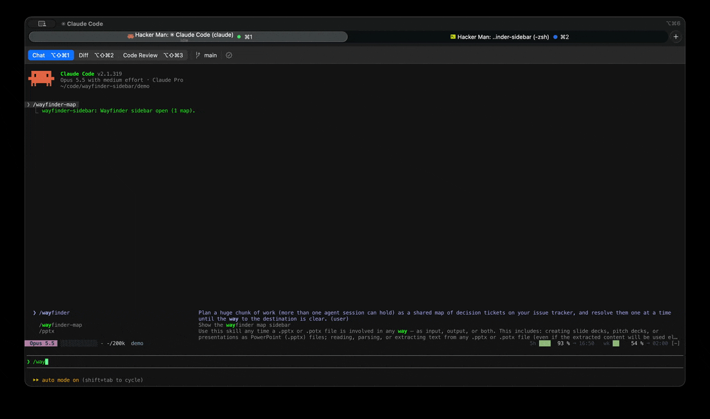

<div align="center">


# wayfinder-sidebar

**Your [`/wayfinder`](https://github.com/mattpocock/skills) map beside the chat. Click ▶ on a ticket and a new Claude Code session starts working on it, with a handoff from this one.**

[](https://github.com/nicksmits1/wayfinder-sidebar/actions/workflows/ci.yml)
[](LICENSE)


<!--
  DEMO: record ~10s and save as assets/demo.gif, then replace this comment with:
  
  See assets/README.md for how to record it.
-->

</div>

```
▐ ◈ WAYFINDER               4 ▸  2 ◐  10 ⧗  ✓ 5 ▌
◎ I4 submitted on Canvas
──────────────────────────────────────────────────
▸ Ready 4
▐ grill  07 P3: user-confirmed paym…        md  ▶ ▌
▐ task   10 Enforce bag allowance s…        md  ▶ ▌
◐ Claimed 2
▐ grill  06 P1 & P2: server-side co… ⠹ you  md  ▶ ▌
▐ task   09 Implement identity & se… ⠹181k  md  ▶ ▌
⧗ Blocked 10
▐ task   13 Implement P1/P2 policy … 06 +2  md  ▶ ▌

◔ Context · 200k a session
  you 06 P1 & P2: serv…  ████████▏░░░░░░░░░░░  92k
  09 Implement identi…   ██████████████████▉░ 181k
```

- **See what can move.** Open tickets are grouped into Ready, Claimed and Blocked, and colored by type.
- **Start work in one click.** `▶` opens a new terminal tab running `/wayfinder <map> <ticket>`.
- **Keep context.** Before launching, this session can write a handoff note for the new one.
- **Run several at once.** Pick a few ready tickets and start them together with one shared handoff.
- **Keep sessions small.** A bar per session shows its context against a 200k budget, following the wayfinder rule of one ticket per session and under 200k tokens. Bars turn yellow at 60% and red when over.
- **Stay in sync.** Every tab sees claims and resolutions from the others within seconds. Tickets flash when they become unblocked.

It only reads your tracker. It never edits your tickets or your wayfinder, grilling or handoff skill files.

## Install

At the prompt of a Claude Code terminal session:

```
/plugin install wayfinder-sidebar --marketplace nicksmits1/wayfinder-sidebar
```

Answer `y` to add the marketplace, then pick a scope. From a shell:

```
claude plugin install wayfinder-sidebar --marketplace nicksmits1/wayfinder-sidebar
```

The sidebar opens on its own when the working directory has a map, and `/wayfinder-map` opens it any time. It docks beside the chat in fullscreen mode when the terminal is at least 110 columns wide.

### Requirements

- **Claude Code 2.1.275 or later** for the one-line install.
- **The [`wayfinder` skill](https://github.com/mattpocock/skills).** New sessions start with `/wayfinder`. [`handoff`](https://github.com/mattpocock/skills) is optional: when it's installed, its rules shape the handoff notes.
- **macOS** to open new sessions in iTerm or Terminal.app. On Linux, tickets open with `xdg-open` and the launch command is copied to your clipboard instead. Windows is untested.
- **The [`gh` CLI](https://cli.github.com), signed in,** for GitHub-hosted maps only.

## Using it

### Rows

- **Type chip.** The word at the left is the ticket type (`grill`, `proto`, `rsrch`, `task`) in its color. A solid chip means the ticket needs you (HITL). Colored text on a dark chip means an agent can run it alone (AFK).
- **Status.** Claimed tickets show a spinner and who holds them: `you` for this session, the context it has used (such as `181k`) for another tab running this mod, or `tab` otherwise. Blocked tickets show the ids they wait on, colored by those tickets' types.
- **Context.** One bar for this session (`you`), and one for each other tab running the mod that holds a ticket on this map. Each bar is labelled with the ticket its session is working on. Each tab reports its own figures after every turn.
- **Footer.** The map's "Not yet specified" items and resolved count sit at the bottom. Press `r` to list resolved tickets.

### Buttons and keys

Each row ends with `md` (or `gh`), which opens the ticket file in your editor or the issue in the browser, and `▶`, which starts a session on it. `▶` only works on ready tickets. Pressing it opens a confirmation under the row:

| Button | Key | What it does |
|---|---|---|
| handoff + start | `h` | This session writes a handoff note, then offers **launch** (`l`), **view** (`v`) and **discard** (`d`) |
| fresh | `f` | Launch now with no handoff |
| cancel | `c` | Close the confirmation |

With the pane focused (`ctrl+x`):

| Key | Action | Key | Action |
|---|---|---|---|
| `j` / `k` | move down / up | `x` | pick a ready ticket (for multi-start) |
| `o` | open ticket | `r` | show / hide resolved |
| `s` | start selected or picked | `g` | refresh now |

The mouse wheel scrolls the pane.

### Handoffs

The mod asks the current session to write the note, following the rules from the `handoff` skill (read from `~/.claude/skills/handoff/SKILL.md` when installed). Notes go in `$TMPDIR/wayfinder-handoffs/`, never in the repo. Starting several tickets writes one note with a section per ticket. A note is deleted once all its tickets close, or after a week. The new session starts as:

```
claude "/wayfinder <map> <ticket>  Context from the session that launched this one: read the \"## <ticket>\" section of <note> before anything else."
```

## Trackers

- **Local markdown:** `.scratch/<effort>/map.md`, with tickets in `tickets/` or `issues/`. Two ticket formats work: YAML frontmatter (`title`, `type`, `status`, `assignee`, `blocked_by`), or the skill doc's plain lines (`# Title`, `Type:`, `Status:`, `Blocked by:`).
- **GitHub:** open issues labelled `wayfinder:map` in the working directory's repository, read with `gh`. Tickets are the map's sub-issues (or a task list in its body), typed by `wayfinder:<type>` labels, and blocked by GitHub's native issue dependencies (or a `Blocked by: #n` line).

Task tickets count as AFK unless the file has `hitl: true` or the issue has a `wayfinder:hitl` label.

Every Claude Code tab runs its own copy of the mod against the same tracker. A tab's own edits show at once. Other tabs' edits show within a few seconds, because the mod checks file modification times. GitHub maps refresh every 45 seconds.

## Settings

Change these in `/plugin` → wayfinder-sidebar → configure, or under `pluginConfigs` in settings:

| Setting | Default | |
|---|---|---|
| `launcher` | `iterm` | `iterm` (new iTerm tab), `terminal` (new Terminal.app window) or `copy` (copy the command). Other systems always copy. |
| `editor` | system opener | Command that opens a ticket file, such as `code`, `cursor` or `zed` |
| `pollSeconds` | `3` | How often local files are checked |
| `githubSeconds` | `45` | How often GitHub maps are re-read |
| `contextBudget` | `200000` | Tokens per session where the context bar fills and turns red |

The first launch into iTerm or Terminal makes macOS ask whether Claude Code may control that app.

## Contributing

Bug reports, tracker formats seen in the wild, and launchers for other terminals (kitty, WezTerm, Ghostty, tmux, Linux terminals) are all welcome. See [CONTRIBUTING.md](CONTRIBUTING.md) to run the mod from a clone and run its tests.

## Credits

Built for [Matt Pocock's skills](https://github.com/mattpocock/skills) (`wayfinder`, `grilling`, `handoff`). Ticket colors follow the Proschi plugin's palette.

## License

[MIT](LICENSE)
